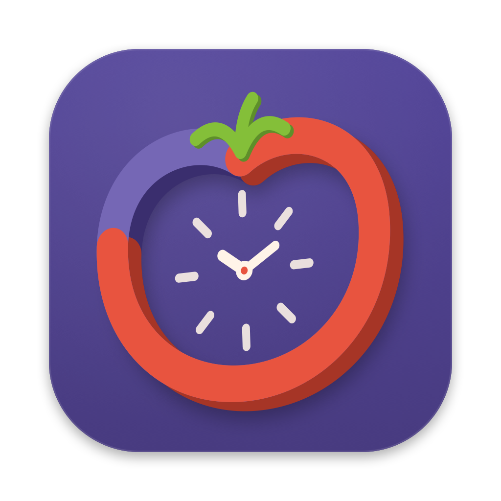

<p align="center">
  
</p>

<h1 align="center">Tiempo Pomo</h1>

A calm, glassy Pomodoro timer for macOS. One centred dial, your own session presets, chimes and notifications at every change, and a countdown in the menu bar. Colours are borrowed from [Glassine](https://github.com/BlitzBlutzBlast/glassine).

## Download

From [Releases](../../releases/latest), pick one:

- **TiempoPomo-x.y.z.pkg**: double-click and it installs into Applications. The first time, approve it in System Settings → Privacy & Security → *Open Anyway*.
- **TiempoPomo-x.y.z.dmg**: drag the app to Applications, then **right-click → Open** the first time.

The app is ad-hoc signed, not notarized, so macOS asks once.

## Privacy: no internet, enforced

Tiempo Pomo never goes online. That's enforced, not just promised:

- It runs in the **App Sandbox with no network entitlement** ([`Resources/Tiempo Pomo.entitlements`](Resources/Tiempo Pomo.entitlements)), so macOS refuses any connection it tries to make. Its only other permission is read-only access to an audio file you pick in *Add Sound…*.
- [`scripts/check_no_network.sh`](scripts/check_no_network.sh) runs on every build. It fails the build if the source uses a networking API, if the binary imports networking symbols or frameworks, or if the signed app isn't sandboxed or holds a network entitlement.
- No dependencies, no updater, no analytics, no account. Presets and settings live in the app's sandbox container on your Mac.

## What's in it

- **One focused window:** the dial in the middle and the session and its timing as two pills under it. Click the session to switch, or the timing to change focus, break and rounds for this run. Start / Pause sits underneath, and a single line at the bottom shows today's totals. During breaks the whole window leans toward the break colour, so you can tell the phase from across the room. A finished session ends with a summary ("4 rounds · 2h 40m focused").
- **Mini timer (optional):** a small always-on-top pill with the time and pause that follows you across Spaces. Turn it on or off in Settings › General, from the menu bar, or with its own ✕.
- **Menu bar:** a countdown (minutes by default, or seconds, or just the icon) and a popover with the time, controls, session picker and shortcuts. Close the window and Tiempo Pomo leaves the Dock but keeps running in the menu bar; it returns to the Dock when you open the window again (turn this off in Settings › General).
- **Settings (⌘,):** a standard macOS Settings window.
  - *Sessions:* add, name, duplicate and delete sessions. Each has focus and break length, rounds or *repeat until stopped*, and an optional long break. It starts with:

    | Session | Focus | Break | Rounds |
    |---|---|---|---|
    | Default Session | 40 min | 15 min | 4 |
    | School Study | 50 min | 10 min | 4 |
    | Reading Session | 30 min | 5 min | 3 |
    | Mindfulness Session | 10 min | 3 min | 2 |

  - *Appearance:* eleven palettes. Nine glass palettes come from Glassine (Dusk, Ocean, Lavender, Graphite, Sepia Night, Midnight, Moss, Frost, Paper). **Vivid** uses Apple's system colours as gradients over glass lit from behind. **Claude** uses Anthropic's brand palette in a serif face.
  - *Sounds:* volume, a chime for each change (10 built-in sounds, the macOS sounds, or your own files), ringing up to 5 times. Start, Pause, Skip or Reset silences a chime.
  - *Notifications:* each event on or off, background-only, the banner sound, and a test button. Banners get a **Start** button when auto-start is off.
  - *General:* auto-start, the menu bar display, hide from the Dock when closed, keep on top, the mini timer, and today's totals.
- **Accessibility:** every control has a VoiceOver label. The dial reads as "Focus, 24 minutes 10 seconds left. Round 2 of 4". Glass turns solid with *Reduce Transparency*, and text and edges strengthen with *Increase Contrast*.
- **Light on battery:** the timer wakes once a second, only the digits and ring redraw, nothing redraws in windows you can't see, and the menu bar updates once a minute. About 0.5% CPU while running, 0% idle.
- **Shortcuts:** Space starts or pauses, ⌘↩ starts or pauses from anywhere in the app, ⌘→ skips, ⌘R resets, ⌘, opens Settings.

## Build it yourself

```bash
./build.sh 0.1.0          # → dist/Tiempo Pomo.app, TiempoPomo-0.1.0.dmg and TiempoPomo-0.1.0.pkg
swift test --disable-xctest   # the session schedule, saved-session loading, formatting, and every palette's contrast
./release.sh 0.1.0        # test, build, tag, push and publish this Mac's build; CI then swaps in the universal one
```

Swift package, no Xcode project and no dependencies. Needs macOS 14+ and the Swift toolchain (Xcode or the Command Line Tools). Pushing a `v*` tag makes GitHub Actions run the tests, build a universal DMG and attach it to a release.

The look lives in two files: `UI/Palette.swift` holds each palette's raw colours, and `UI/Design.swift` the type scale, spacing and corner sizes every surface shares. Palettes are resolved once into ready-to-draw colour sets (`AppTheme`), nudged where needed until they pass WCAG AA on their own glass; a test fails the build if any palette slips below it.

`swift scripts/make_icon.swift <dir>` redraws the icon as vector geometry (each small size drawn separately) into `<dir>/AppIcon.iconset`; `iconutil -c icns <dir>/AppIcon.iconset -o Resources/AppIcon.icns` packs it. `scripts/make_sounds.swift Resources/Sounds` re-synthesises the built-in sound pack. Every sound is generated from sine partials, so it's all original.
